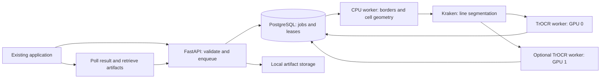

# ScriptaLocal implementation plan

Date: 12 November 2026. Status: HTTP/GPU prototype, artifacts and correction history validated; persistent local and trusted HTTPS deployment are validated; Registers integration and remaining operational work remain open. Model/training quality work is deferred from the current critical path at the owner’s request.

## Outcome

ScriptaLocal will provide an HTTP transcription service that the user's existing crop-marking application can select alongside its current Codex CLI provider. Each request contains a table-row image with visible vertical borders and multiline cells. Return ordered cells, ordered lines, geometry, raw transcriptions, review warnings, and reproducible model provenance. Keep data local after model provisioning.

This repository builds the backend and a small diagnostic client, not a replacement website. A future review interface in the existing application is an integration task. The existing-app contract and synthetic integration fixtures are supplied, and one manuscript row crop is available. Broader representative crops and corrected transcripts remain pending. Integration follows the explicitly versioned service contract and the Registers/Builder handover.

## Deployment decision

Use Docker Engine and Docker Compose directly on the existing Ubuntu host with NVIDIA Container Toolkit.

| Option | Fit | Decision |
| --- | --- | --- |
| Docker Compose on host | Reproducible Python/CUDA environments, explicit GPU assignment, simple local HTTP integration and rollback | Selected |
| Virtual machine | Stronger guest isolation, but requires GPU passthrough and an extra OS/storage lifecycle | No current requirement justifies the overhead |
| LXC | Can expose host GPUs, but adds device permissions and host/container library coordination to this workload | Not selected |

Docker is process isolation sharing the host kernel. It is sufficient for this trusted local workload; it is not a VM security boundary. Do not nest Docker in LXC. Do not install the full eScriptorium or OCR4all stack merely to obtain their underlying OCR engines. Kraken can be integrated directly through its API. Reconsider a full eScriptorium deployment only if annotation and training workspace requirements arise.

## Verified host inventory

Observed using read-only commands on 12 November 2026:

| Resource | Observed |
| --- | --- |
| OS | Ubuntu 26.04.1 LTS, x86_64 |
| CPU | Xeon E5-2697 v2, 12 cores / 24 threads; AVX present, AVX2 absent |
| Memory | 121 GiB total; about 77 GiB available at inspection |
| GPU 0 | NVIDIA GeForce RTX 3060, 12,288 MiB VRAM |
| GPU 1 | NVIDIA GeForce RTX 3060, 12,288 MiB VRAM |
| Driver | 595.112.07; nvidia-smi reports CUDA compatibility 13.2 |
| Docker | Engine CLI 29.9.3; Compose v5.7.1; daemon query succeeds |
| NVIDIA tooling | nvidia-ctk executable present; no NVIDIA runtime name observed in queried Docker runtime map |
| Root filesystem | About 13 GiB available, 95% used |
| Other disks | Two approximately 1.8 TB disks have ZFS-member partitions; capacity, pool ownership and usable storage unverified |
| Repository | Empty project directory initially; no Git repository |

Presence of nvidia-ctk does not establish GPU-container functionality; CDI configuration may also be relevant. Test actual container enumeration and GPU computation. The CUDA number in nvidia-smi is not an installed application toolkit version. Do not install CUDA 13.2 simply to match that display.

Storage is the first operational prerequisite. Budget initially for at least 60 GiB free on the chosen build/model/data storage, plus the retained manuscript corpus and independent backup capacity. This is a planning allowance, to be revised using actual image and model sizes. Inspect Docker's data root and ZFS datasets before choosing paths. Do not assume the ZFS disks are free or repurpose them. Configure build/model/data paths explicitly and prevent unbounded caches and logs.

## Architecture

Compose services: API, PostgreSQL, preprocessing/segmentation worker, recognition worker for GPU 0, and optional recognition worker for GPU 1. The pipeline stages are durable jobs in PostgreSQL; use atomic claims with SKIP LOCKED, lease expiry, heartbeats, bounded retries and idempotent writes. No Redis/Celery service initially. Store images and large geometry artifacts on a mounted filesystem and reference them from the database. Use atomic rename and checksums for artifact publication, and clean orphaned temporary files safely.

Use separate dependency locks/images for Kraken and TrOCR if their PyTorch/Transformers constraints conflict. Prefer an established CUDA-enabled PyTorch runtime with a compatible Python version, then pin the combination after this host passes imports, CPU image processing, and a GPU inference smoke test. Use minimal CPU images for the API and OpenCV-only components where practical. Do not pick exact package versions before compatibility validation.

## GPU policy

Start with GPU 0 for recognition and CPU segmentation. The approximately 0.3B-parameter Bern model should fit a 12 GB device, but verify actual memory use with long lines and generation settings. Keep the model resident; use inference mode, bounded line batches and validated precision. Begin with FP32 correctness, then compare FP16 output and memory before making it default.

Benchmark Kraken segmentation on CPU; use GPU 1 for it if CPU latency dominates. Otherwise enable a second independent recognition worker on GPU 1 to process separate jobs. Route durable work to available workers without duplicating final results. Compare throughput and latency with one and two workers. No tensor parallelism, VRAM pooling, NVLink assumption, or distributed training in the initial deployment. Expose only the assigned GPU to each worker and use its container-local device index.

Initial caps: two concurrent CPU preparation jobs with limited native-library threads; one active inference batch per GPU; configurable batch size, image pixel count, upload size, job timeout, queue depth and artifact retention. Derive production limits from measurements, rather than exhausting all 24 host threads or host RAM.

## Image and recognition pipeline

1. Decode PNG/JPEG and single-image TIFF initially; reject unsupported, corrupt, oversized or multi-frame inputs with actionable errors. Preserve original bytes and image dimensions; account for orientation. Do not fetch user-provided remote URLs.
2. Estimate mild rotation; retain reversible affine transforms. Use grayscale/thresholded copies for geometric detection, preserving the original pixels for recognition.
3. Find vertical border candidates using adaptive thresholding, morphological line extraction and corroborating line/projection evidence. Handle slightly slanted, broken and double borders. Merge duplicate detections and use image edges for outer limits when needed. Avoid treating tall handwriting strokes as dividers.
4. Produce cell polygons, left-to-right order, detection diagnostics and ambiguous-layout warnings. Support no divider as a single-cell input, variable cell count, blank cells, uncertain/merged cells and user-supplied boundary corrections. Never silently assert a fixed table schema or a confident layout when evidence is ambiguous.
5. Preserve handwriting touching borders. Compare padded cell crops and conservative border masks; do not broadly erase lines in the only recognition image. Flag overlap across cells for review. Keep mappings back to the original crop.
6. Run a pinned Kraken baseline segmentation model per cell. A checksum-pinned bundled Kraken candidate is the runtime baseline; broader segmentation quality selection still requires benchmark evidence and license review. Extract ordered line images using baseline geometry, padding and coordinate transforms. Flag missed/overlapping/very long lines and segmentation failures.
7. Transcribe each single line with dh-unibe/trocr-kurrent-XVI-XVII as the first candidate for 16th–18th-century German Kurrent. Compare dh-unibe/trocr-kurrent where dates/hands justify it, and a license-compatible Kraken recognition model on the same held-out samples. Do not load Bern Transformers weights into Kraken as if they were Kraken models.
8. Assemble line and cell results without rewriting spellings, expanding abbreviations, translating, guessing names, or converting ditto marks into inferred values. Keep blank, unreadable, failed and needs-review states distinct. Generation truncation must be visible; split unusually long lines only with explicit geometry and measured validation.
9. Return structured results and optional image overlays. Retain raw output and revisioned human corrections separately. A change to a divider should invalidate affected downstream artifacts and regenerate them without overwriting previous evidence.

Model-card scores are not expected accuracy on these documents. Swiss-biased German training may struggle with Latin formulas, Slovenian names and unfamiliar hands. Raw sequence scores are not calibrated confidence percentages. Mark review reasons and only expose confidence if its definition and validation are documented.

## API and external integration

Versioned initial contract:

- `GET /health/live`: process health.
- `GET /health/ready`: database, storage and available pipeline capability; distinguish model warming from readiness.
- `GET /v1/models`: installed models, revisions, scripts, licenses and readiness; no implicit downloads.
- `POST /v1/jobs`: multipart image plus optional client reference, model choice and corrected divider geometry; returns 202 with job ID. Support an idempotency key.
- `GET /v1/jobs/{id}`: queued/running/succeeded/failed/cancelled state, current stage and review warnings.
- `GET /v1/jobs/{id}/result`: versioned JSON with original dimensions/hash, transforms, cells, line polygons, text, states, model revisions and timings.
- `GET /v1/jobs/{id}/artifacts/{artifact_id}`: controlled original/overlay/crop retrieval, never arbitrary paths.
- `POST /v1/jobs/{id}/cancel`: best-effort cancellation with explicit terminal semantics.
- `DELETE /v1/jobs/{id}`: coordinated job/artifact deletion subject to documented retention.
- `POST /v1/jobs/{id}/revisions`: save divider/line/text corrections with optimistic concurrency and provenance; geometry edits schedule a new result revision.

Cell schema includes stable ID, order, original-coordinate polygon, state, lines, newline-preserving text and warnings. Line schema includes ID/order, polygon/baseline, text, state and model identity. Job responses distinguish partial artifacts from successful final output. Define request size limits, error schema, authorization scope, retention and coordinate conventions in OpenAPI before wiring the caller.

Ship a CLI/client example that uploads a crop, polls, and writes JSON plus text. Integrate into the existing app when its source/contract is available: add a Local HTR provider, configurable server-side service URL/token, progress, retry and cell-preserving import. Keep Codex selection explicit. A browser must not call this host's localhost by assumption: prefer a server-side adapter; direct browser use needs narrowly configured CORS and secure network routing.

## Reliability, security and data lifecycle

Bind to 127.0.0.1 initially. Database/workers are internal-only. For an external application on another host, configure LAN routing, scoped bearer credentials and HTTPS at a proxy before exposure. Keep secrets in protected environment files or secrets mounts; avoid plaintext tokens in logs or version control. Validate paths, ownership and image decoding limits. Run application containers without root where feasible and set resource/health/restart limits.

Provision pinned model files once, verify checksums/licenses, then use offline cache loading. Demonstrate inference without outbound network. Record model and preprocessing versions in every result. Keep debug artifacts opt-in with expiry; log IDs, stages, timings and errors without manuscript text. Set rotation, queue backpressure and disk-space checks. A GPU OOM should reduce a bounded batch or fail clearly without infinite retries or switching providers.

Back up PostgreSQL and referenced artifacts with a consistent manifest; keep model manifests and immutable correction history. Test restoration into a separate location. Define default retention during implementation (proposed 30 days for raw jobs/debug artifacts, with explicit keep/delete settings); do not purge human-corrected reference material implicitly. Document cancellation, interrupted workers, stale leases, restart recovery, upgrades and rollback. Database migrations require a tested rollback or restore route.

## Evaluation and release gates

Collect at least 30 representative real row crops across available hands, scans and layouts, with at least 200 transcribed lines where available. Annotate dividers, cells, line order, verbatim text and uncertain passages. Reserve roughly one third by page/hand for held-out evaluation, avoiding adjacent-line leakage. Keep source permissions and local storage restrictions documented. Samples are an external input, not a reason to claim synthetic accuracy.

Measure divider and cell-count errors, line detection/ordering errors, CER/WER with explicit normalization, name/date errors, blank-cell false positives, review rate, latency p50/p95, throughput and peak VRAM/RAM. Report results by handwriting/script group. Compare oracle/manual segmentation with automatic segmentation to separate OCR errors from layout errors. Compare TrOCR and Kraken recognition on identical samples. No accuracy promise before this benchmark; decide acceptable manuscript accuracy with the user after the baseline report.

Release gates: deterministic geometry fixture checks; correct identity/order of blank cells; real image-to-JSON GPU inference; bounded invalid-input failures; offline inference; restart/retry/cancellation idempotency; GPU assignment and one/two-GPU measurements; backup restoration; existing-app round trip when available. General latency target is interactive use, but establish numeric limits from the baseline and caller needs before acceptance. If automatic layout fails on a class, return needs-review and use manual divider correction rather than fabricate output.

## Delivery sequence

1. Foundations: repository, safe storage, GPU container and CPU compatibility checks, pinned runtime, API contract and sample specification.
2. Vertical slice: one image → one manually bounded cell → real Kraken line extraction → real TrOCR inference → structured result. Validate before building robust table heuristics.
3. Table pipeline: automatic divider detection, preserved geometry, blank/ambiguous states and overlay diagnostics.
4. Service: durable job stages, offline model provisioning, bounded retries, authentication and client adapter.
5. Validation and operation: comparative corpus benchmark, second GPU measurements, recovery/backup and external app acceptance.
6. Optional improvement: targeted fine-tuning only after the baseline identifies a need and sufficient corrected training/validation data exists. Record model lineage; make no promise that a fixed small page count guarantees accuracy.

The exact executable work and completion evidence live in `../tasks.md`. Phase 1 should resolve capacity and compatibility before any large downloads. Implementation is not part of this documentation deliverable.

## Sources checked on 12 November 2026

- [Docker Compose GPU assignment](https://docs.docker.com/compose/how-tos/gpu-support/): device reservations and explicit device IDs.
- [NVIDIA Container Toolkit installation](https://docs.nvidia.com/datacenter/cloud-native/container-toolkit/latest/install-guide.html) and [platform support](https://docs.nvidia.com/datacenter/cloud-native/container-toolkit/latest/supported-platforms.html): driver/runtime prerequisites and Ubuntu support. Actual host operation still needs testing.
- [Bern 16th–18th-century Kurrent model card](https://huggingface.co/dh-unibe/trocr-kurrent-XVI-XVII): MIT license, approximately 0.3B parameters, single-line input and Swiss-biased training. Use the model-specific VisionEncoderDecoder architecture; do not assume auto-generated hosting snippets are validated deployment instructions.
- [Bern 19th-century Kurrent model card](https://huggingface.co/dh-unibe/trocr-kurrent): comparison candidate.
- [Kraken documentation](https://kraken.re/main/index.html): direct API/CLI, segmentation/recognition and model repository.
- [OpenCV line extraction tutorial](https://docs.opencv.org/4.x/dd/dd7/tutorial_morph_lines_detection.html): morphological extraction as a starting method, not proof of historical-table robustness.

## Validation update and configuration decisions, 12 November 2026

Root storage now has approximately 179 GiB available before validation image pulls, resolving the original capacity constraint. Use project-local ignored `data/` directories for models, artifacts, database, reference crops and build cache. Docker remains at `/var/lib/docker`; no daemon relocation is needed. All paths are environment configuration, not application constants.

The user selected `/srv/storage/scriptalocal-backups` as an initial local backup location on the existing large pool, with Synology NFS to be mounted later. This root is configurable; subsequent NFS deployment must verify the expected mount before backup to prevent accidental fallback into an unmounted local directory. If a management UI is introduced, expose backup destination/settings there with validation and protected credentials, without requiring source changes. Other operational settings (service URL, GPU allocation, model selection, paths, retention, limits and concurrency) must likewise be configurable.

ZFS is online with no known data errors, but one member reports five read errors. No pool repairs, error clearing or disk reconfiguration were performed. Local backups can validate restoration, but independent/off-machine recovery remains pending the NAS. The pool already contains other workloads and must not be treated as a spare blank disk.

GPU container computation passed using existing CDI definitions and pinned PyTorch 2.7.1/CUDA 12.6 image, with exactly one visible device per container. The Compose implementation will use CDI device mapping on this host rather than adding an NVIDIA runtime or restarting Docker. Evidence and commands are in `docs/validation/`.

## Image and contract validation update, 12 November 2026

A real row crop is now supplied; larger reference data and corrected transcripts remain pending. HTR-007 and HTR-011 have schema/decoder implementations with 24 passing CPU tests. The designed OpenAPI contract and examples live under `docs/api/`; this does not deploy the HTTP routes. Original image geometry uses encoded-raster pixel edges, with explicit EXIF mapping and additional affine transforms. Raw recognition and saved human corrections are distinct fields. The existing app coder should review this concrete contract alongside its current interface.

## Layout and baseline model update, 12 November 2026

The baseline profile and offline manual-cell slice are now pinned and schema-exported (HTR-009/010). This does not accept manuscript quality or deploy the HTTP API. Reusable layout and ink-preserving context extraction are implemented with synthetic geometry tests and a reviewed real-row overlay; HTR-012/013 remain open for corpus/downstream acceptance. Automatic layouts always require review, weak exterior shadow proposals are retained in metadata, and original pixels are not erased by masks. Public divider endpoints are interpreted in the original encoded frame and validated after one EXIF transform. See `docs/layout-validation.md` for reproduction and limits.

## Agent file intake, requested 12 November 2026

The user requested an API through which another AI coding agent can upload files to a folder chosen by this agent/operator. A separate, scoped file-intake service now implements that flow. Its small private SQLite registry stores transfer tickets/receipts only; PostgreSQL remains the OCR job-state/queue decision. Uploading never executes a file or starts transcription. Destination aliases, relative subfolders, limits, expiry and the public base URL are configurable; administrator credentials remain private and uploading agents receive only request-scoped tokens.

The service runs nonroot with read-only root storage and limited writable mounts at loopback port 8091. Eighteen integration checks plus actual HTTP/checksum/restart/retry/revocation/log-redaction checks pass. A two-file app-contract request is prepared under ignored private storage. Network location of the other agent is still needed before choosing a reachable HTTPS/private-tunnel endpoint. See `docs/agent-uploads.md`; this does not implement `/v1/jobs`.

## Intake LAN selection, 12 November 2026

The user explicitly selected `http://10.10.100.209:8091` after host inspection showed the address is in 10.10.100.0/24. The intake service now binds specifically to that address. Configured ticket/handout URLs were updated without changing credentials. A scoped upload from a separate container network namespace through the LAN URL passed with correct saved checksum and authorization; the actual coding-agent handover remains pending. No broader host network or firewall reconfiguration was performed.

## Queue and reusable segmentation update, 12 November 2026

HTR-016 is complete with 20 real PostgreSQL checks and actual WAL recovery after terminating only the isolated test database. HTR-014 now has reusable per-cell Kraken segmentation, seven additional geometry/error tests and a three-line offline real-cell run. Context and padding produce explicit boundary warnings; raw polygons are retained alongside source-clipped result polygons. Full-row recognition/HTTP service and manuscript-quality acceptance remain open. The external application contract has been received; the application has a coding team whose implementing agent can differ from the integration contact. Keep cross-project handovers self-contained.

## Full-row pipeline and comparative model update, 12 November 2026

The full row now passes all three leased GPU stages, retaining original bytes, 18 review-required cells, 24 assigned line readings and immutable configuration/geometry/line evidence. A 10-second lease was renewed through 58-second actual segmentation with 19 heartbeat calls and identical results. The worker image has an exact 171-package lock; 11 synthetic stage-integration tests and 65 core checks pass. HTTP deployment and manuscript quality remain open.

The owner explicitly authorized direct assistant image reading as an additional diagnostic reference. Such AI readings are private, versioned and not human-confirmed ground truth. The newer Bern XVI–XIX model has been provisioned and tested on the same frozen 24 crops. A manually reviewed single-word experiment implicates oversized line crops, and ruling-only detections produce spurious text in both models. Crop rendering and segmentation quality must be evaluated alongside model size; no final best-model claim is established.
